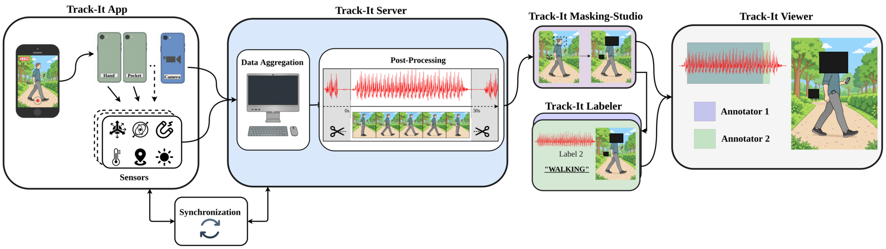

<div align="center">

# Track-It

**An Open-Source Toolkit for Synchronized Multimodal Data Collection, Annotation, and Face Anonymization**

Record time-synchronized sensor and video data from multiple smartphones and build high-quality multimodal datasets for Human Activity Recognition (HAR), end to end.

[](LICENSE)
[](https://h-iaac.github.io/track-it/)
[](#)
[](#requirements--environment-setup)
[](android_app/)

[**Demo**](https://h-iaac.github.io/track-it/) &nbsp;·&nbsp; [**Paper (soon)**](#) &nbsp;·&nbsp; [**Quickstart**](#requirements--environment-setup) &nbsp;·&nbsp; [**Data Format**](#data-format-sensor-csv-columns)

<br>



</div>

---

Track-It carries multimodal data end to end: synchronized collection across several phones, server-side alignment and validation, automatic face anonymization, activity labeling, and inspection. A smartphone acquisition app and a server backend share a common time reference (Cristian's algorithm), so the sensor streams and video from every device land on a single timeline, validated at up to 100 Hz with inter-device lag below one sampling period. Although built for HAR research, its components are reusable in any multimodal collection workflow.

**Five tools integrated at a single pipeline:**
- **Track-It App**: Android app for synchronized multi-device sensor and video recording.
- **Track-It Server**: Server-side processing application with Cristian's algorithm clock synchronization (Preprocessor + Postprocessor).
- **Track-It Masking Studio**: Interactive and automated video face anonymization combining multi-model tracking and manual audit.
- **Track-It Labeler**: Multimodal time-series activity labeling interface synchronized with video playback.
- **Track-It Viewer**: Multi-annotator inspection, visualization, and consensus consolidation interface.

> **Paper:** *"Track-It: An Open-Source Toolkit for Synchronized Multimodal Data Collection, Annotation, and Face Anonymization"*. Preprint coming soon on arXiv.

---

## Architecture & Services

| Service / Tool | Component Path | Technology | Port | Description |
|---|---|---|---|---|
| **Track-It Masking Studio** | `face_masking_studio/` | FastAPI + ONNX/OpenCV | `8000` | Automated & interactive face anonymization with multi-pass tracking. |
| **Track-It Server** (Pre) | `server-processing/preprocessor/` | Node.js + Express | `8080` | Ingestion endpoint, upload handling, authentication, and session packaging. |
| **Track-It Server** (Post)| `server-processing/postprocessor/`| Python + Pandas/Scipy | `7998` | Watchdog daemon: sensor cleaning, Cristian's clock sync, and pipeline triggering. |
| **Track-It Labeler** | `annotation_interface/` | Dash + Plotly | `8050` | Interactive multimodal time-series labeling with synchronized video playback. |
| **Track-It Viewer** | `viewer_interface/` | Dash + Plotly | `8052` | Dataset inspection, multi-annotator consensus visualization, and export. |
| **Track-It App** | `android_app/` | Android (Java / CameraX) | Client | Synchronized sensor (IMU, GPS, ambient) and video collection client. |

---

## Requirements & Environment Setup

- **Python 3.12 or newer** (required by `numpy==2.5.3`, `scipy==1.18.1`, `pandas==3.0.6`).
- **Node.js 18 or newer** (for the server preprocessor).
- System tools: `ffmpeg`, `ffprobe`, `libmediainfo`, and `curl` on your `PATH`.
- **Android development (optional):** JDK 17, Android SDK (`compileSdk 34`).

### Quick Python Setup

A single root virtual environment covers all Python tools:

```bash
python3.12 -m venv .venv
source .venv/bin/activate
pip install -r requirements_cpu.txt   # or requirements_gpu.txt with CUDA 12
```

---

## Unified Orchestrator (`run_all.sh`)

The root script `./run_all.sh` manages all 5 services in their strict topological startup order:

```bash
./run_all.sh start          # Starts all services in detached background mode
./run_all.sh stop           # Stops all running services cleanly
./run_all.sh restart        # Stops, waits, and restarts all services
./run_all.sh status         # Displays status table, active ports, and LAN IP
./run_all.sh foreground     # Runs orchestrator in foreground with live terminal
./run_all.sh logs [target]  # Stream logs: face-mask, server-pre, server-post, annotation, viewer, all
```

### Strict Startup Order

1. **Masking Studio (Port 8000):** Must start first so the postprocessor can dispatch asynchronous auto-anonymization requests via `POST /api/video/dataset:<session>/auto-anonymize`.
2. **Server Preprocessor (Port 8080):** Ingestion server for phone uploads.
3. **Server Postprocessor (Port 7998):** File watchdog daemon monitoring incoming uploads.
4. **Annotation Interface (Port 8050):** Interactive time-series labeling interface.
5. **Dataset Viewer (Port 8052):** Multi-annotator inspection and consensus analysis.

---

## Physical Setup & Network Architecture (Validation & Field Setup)

For real-world experimental collection and the validation experiments reported in the paper, all tools operate in an **isolated local area network (LAN) using a dedicated internal Wi-Fi router**:

```text
               ┌────────────────────────────────────────────────────────┐
               │           Dedicated Local Wi-Fi Router (No WAN)        │
               │               Local Subnet: 192.168.1.0/24             │
               └───────────┬────────────────────────────────┬───────────┘
                           │ Wi-Fi / Ethernet               │ Wi-Fi
                           ▼                                ▼
       ┌──────────────────────────────────────┐   ┌───────────────────────────────────┐
       │     Workstation / Processing Server  │   │      Recording Smartphones        │
       │    Local IP: http://192.168.1.100     │   │  • Device 1 (Annotator + Video)   │
       │  • Server Preprocessor (:8080)       │   │  • Device 2 (Right Pocket IMU)    │
       │  • Server Postprocessor (:7998)      │   │  • Device 3 (Left Pocket IMU)     │
       │  • Face Masking Studio (:8000)       │   │  • Device 4 (Right Hand IMU)      │
       │  • Annotation Interface (:8050)      │   │  • Device 5 (Crossbody Bag IMU)   │
       │  • Dataset Viewer (:8052)            │   └───────────────────────────────────┘
       └──────────────────────────────────────┘
```

- **No Internet Required:** The router does **not** need an external WAN/internet connection. It only provides a closed, stable Wi-Fi network with DHCP for local communication between devices. This avoids institutional network drops, public firewall blocks, and internet routing jitter.
- **Server Binding (`0.0.0.0`):** The Server preprocessor binds to `0.0.0.0:8080`, allowing it to receive incoming requests and data streams from any device on the local network.
- **Server Address on Mobile:** In the Android app, configure the server address using the host PC's LAN IP (e.g. `http://192.168.1.100:8080`). **NEVER use `127.0.0.1` or `localhost`**, which points to the phone itself and fails immediately.
- **Finding Your LAN IP:**
  - Run `./run_all.sh status` — the status table outputs the exact `Phone Server Config` address.
  - Or run: `ip -4 addr show | grep -E "inet 192\.168|inet 10\."` (Linux/macOS) or `ipconfig` (Windows).

> [!WARNING]
> **Firewall Warning:** If the server workstation has an active firewall (e.g., Linux UFW/iptables or Windows Defender Firewall), ensure port **`8080`** is allowed for inbound traffic on the local subnet. If blocked, smartphones will fail to ping or upload to the server even when connected to the same Wi-Fi.

---

## Phone Preparation Checklist (Overview)

Before data collection across one or multiple smartphones:

1. **Installation:** Install **Track-It App** either directly from Google Play Store or build and install the debug APK via USB Debugging (`adb install`).
2. **Wi-Fi Connection:** Connect all phones to the **same dedicated Wi-Fi router** as the server.
3. **Server Address:** In app *Settings → Server Upload*, set the workstation IP (e.g., `http://192.168.1.100:8080`).
4. **Device Placement:** In multi-device experiments, assign each phone its physical location under *Settings → Device Position* (e.g., *Right Pocket*, *Camera*).
5. **Permissions:** Grant **Camera** (for the video recording device) and **Location** (*"Allow all the time"* if collecting GPS).
6. **Battery Optimization (Critical):** Set app battery usage to **"Unrestricted"** (*Settings → Apps → Track-It App → Battery*) to prevent Android Doze from suspending background sensor threads.

See [android_app/README.md](android_app/README.md) for full step-by-step device configuration.

---

## Dataset Flow & Session Manifest (`session_manifest.json`)

All tools support two operational modes, with **Dataset Flow enabled by default**:

| Mode | Behavior | Use Case |
|---|---|---|
| **Dataset Flow** *(Default)* | Automated pipeline: phone uploads automatically transition through `data/<session>/` with a unified `session_manifest.json`, synchronized video, and multi-annotator tracking. | Full multimodal collection and study workflows. |
| **Standalone** | Manual file mode: load individual CSVs, standalone videos, or export one-off files without pipeline constraints. | Offline inspection, debugging single sensors, or ad-hoc labeling. |

### How to Toggle Dataset Flow

- **Android App:** Open *Settings → Server Upload → Track-It Dataset Flow* switch.
  - **ON (Default):** Generates `session_manifest.json` and packages multi-device streams.
  - **OFF:** Legacy raw CSV upload.
- **Annotation Interface:** Toggle the switch in the top header:
  - **Dataset Flow (Default):** Session dropdown populated from `data/`; updates manifest and saves to `data/<session>/annotations/<session>_Ann_<annotator>.csv`.
  - **Standalone:** Enables manual drag-and-drop file upload.
- **Masking Studio:** Top navigation toggle:
  - **Dataset Flow (Default):** Reads from and renders to `data/<session>/videos/`.
  - **Standalone:** Reads from local `videos/raw/`.
- **Dataset Viewer:** Directly inspects `data/<session>/` and automatically detects live annotations.

### What `session_manifest.json` Stores

The `session_manifest.json` file acts as the state backbone that coordinates all tools throughout a session's lifecycle:

```json
{
  "session_id": "236d6d6c-99be-4479-9232-f4376ca0769e",
  "metadata": {
    "experiment": "eval",
    "subject": "01",
    "initial_activity": "all",
    "timestamp_start": 1715580658626
  },
  "pipeline_status": {
    "server_processed": true,
    "face_masked": true,
    "annotated": true
  },
  "artifacts": {
    "sensors_dir": "sensors",
    "clean_sensors": [
      "sensors/LinearAccelerometer_Right Pocket.csv",
      "sensors/Accelerometer_Right Pocket.csv",
      "sensors/Gyroscope_Right Pocket.csv"
    ],
    "raw_video": "videos/session_video.mp4",
    "anonymized_video": "videos/eval [all] [01]_masked_1.mp4",
    "annotations_dir": "annotations",
    "annotation_files": [
      "annotations/eval [all] [01]_Ann_annotator1.csv"
    ]
  },
  "activity_labels": ["SITTING", "STANDING", "WALK_SPONT", "RUN"]
}
```

- **`metadata`**: Collection profile, participant ID, experiment title, and synchronized start epoch.
- **`pipeline_status`**: Boolean lifecycle flags (`server_processed`, `face_masked`, `annotated`) indicating which stages have completed.
- **`artifacts`**: Relative paths to synchronized sensor signals (`sensors/`), raw/masked videos (`videos/`), and annotator outputs (`annotations/`).
- **`activity_labels`**: Dynamic activity label catalogue synchronized across tools.

---

## Data Format (sensor CSV columns)

Each per-sensor CSV produced by the pipeline has the following columns:

| Column | Meaning |
|---|---|
| `VideoTimelapse` | Time of the sample on the shared video timeline, in milliseconds, starting at 0 at the video start. |
| `Experiment Name` | Experiment/profile name. |
| `Power Consumption (mAh)` | Approximate energy use reported by the sensor API. |
| `Sensor Frequency (Hz)` | Configured polling rate `f_s`. |
| `Timestamp Server` / `Timestamp Local` | Server-referenced and device-local epoch timestamps (ms). |
| `Value 1`, `Value 2`, `Value 3` | Sensor readings (see mapping below). |
| `Data Status` | `VALID` or `INVALID` (stale/duplicated or sensor-flagged sample). |

**`Value 1` / `Value 2` / `Value 3` mapping.** For the tri-axial sensors
(Accelerometer, Gyroscope, Linear Accelerometer, Gravity, Magnetometer) these are
the **x, y, z** components, respectively. Scalar sensors (Ambient Light,
Proximity, Ambient Temperature) use only `Value 1`. GPS uses `Value 1` and
`Value 2` for latitude and longitude. Units follow the Android sensor API
(e.g., m/s² for acceleration, rad/s for angular velocity, µT for the magnetometer,
lux for ambient light).

---

## Directory Structure

```text
data/<session>/
├── session_manifest.json     # Pipeline metadata, sensor mappings, and execution flags
├── raw_sensors/              # Raw sensor CSVs uploaded from mobile clients (if preserved)
├── sensors/                  # Cleaned, resampled, and aligned sensor time-series
├── videos/
│   ├── <session>.mp4         # Original synchronized video capture
│   ├── masks_data/           # Multi-pass face masking JSONL metadata
│   └── <session>_masked_0.mp4# Anonymized video passes
└── annotations/
    └── <session>_Ann_<annotator>.csv # Time-series change points & activity labels
```

---

## License & Credits

Released under the [MIT License](LICENSE), Copyright &copy; 2026 H.IAAC Hub &mdash; Universidade Estadual de Campinas (Unicamp).

- **Android App:** Based on [H-IAAC/sensor-toolkit](https://github.com/H-IAAC/sensor-toolkit) by H.IAAC and Instituto de Pesquisas Eldorado (Felipe Augusto, Saulo A. Moraes, Daniel Adam Miranda, and contributors).
- **Server Processing:** Based on [H-IAAC/data_collection_server](https://github.com/H-IAAC/data_collection_server) by H.IAAC and Instituto Eldorado (Saulo A. Moraes, Amparo Díaz Muñoz, and contributors).
- **Annotation Interface:** Based on the `Time-Series-Labeling-Tool` branch of [H-IAAC/viewer_tool_jupyter](https://github.com/H-IAAC/viewer_tool_jupyter).
- **Face Anonymization:** MediaPipe, YOLOv7-tiny (PINTO0309), and OpenCV rendering pipelines.
- **Typography:** [JetBrains Mono](https://github.com/JetBrains/JetBrainsMono) (SIL Open Font License 1.1).
- See [THIRD_PARTY_NOTICES.md](THIRD_PARTY_NOTICES.md) for full licensing details of third-party assets and model weights.
